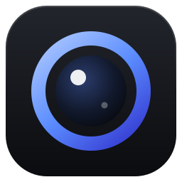

<p align="center">
  
</p>

<h1 align="center">CamLite</h1>

<p align="center">
  Your webcam at full hardware quality in every app — a tiny native replacement for Logi Capture.
  <br>
  <a href="https://github.com/Lancito01/camlite/releases/latest"><b>Download</b></a> ·
  <a href="#how-it-works">How it works</a> ·
  <a href="#building">Build</a>
</p>

<p align="center">
  <a href="https://github.com/Lancito01/camlite/actions/workflows/ci.yml"></a>
  <a href="https://github.com/Lancito01/camlite/releases/latest"></a>
  
  
</p>

Use your webcam at its real hardware quality (1080p30 / 720p60, 16:9) in Zoom, Teams,
Discord, OBS and browsers — without the recording, scenes, overlays and background CPU of
Logi Capture. Rust · Media Foundation · ~5 MB · zero background processes.

## Why

Many apps open a webcam at a default 640×480 (4:3) / 30 fps or lower. Logi Capture works
around that by re-publishing the camera as a virtual camera, but it's an Electron/XSplit
stack that is slow to start and heavy to keep running.

CamLite does the same job the lightweight way:

- **"CamLite Camera"** — a Windows 11 virtual camera that only offers your chosen HD mode,
  so Zoom, Teams, Discord, OBS and browsers can't fall back to 4:3 low-res.
- **Hardware controls** — zoom, pan/tilt, focus, exposure, white balance, brightness,
  contrast, saturation, sharpness, gain and backlight compensation are set over UVC, i.e.
  done *by the camera itself*. They cost no CPU.
- **Constant frame rate** — turns off the camera's low-light "exposure priority", which
  otherwise silently halves the frame rate in dim rooms (a C922 drops 30 → 15 fps).

## Set it and forget it

**You don't keep CamLite open.** Set up your camera once, close the window, and you're done.

1. **Open CamLite and tweak.** Pick 1080p · 30 or 720p · 60, zoom, focus, colors. Every
   change is saved instantly — there's no Save button.
2. **Close it.** Nothing stays running: no tray icon, no service, no startup app.
3. **Pick "CamLite Camera" in your video app.** Whenever an app opens it, Windows wakes
   CamLite's camera component, which applies your settings to the webcam and streams your
   chosen resolution. When the app closes the camera, it goes back to sleep.

Your settings live in a file, not in a running program, and they're re-applied every time
the camera starts — so they survive reboots and unplugging the webcam.

**Do I need "Apply settings when Windows starts"?** Only if some apps use your webcam
*directly* (e.g. "C922 Pro Stream Webcam" instead of "CamLite Camera"). Webcams forget their
settings when they lose power, so this option re-applies them for a fraction of a second at
sign-in and exits. If you always pick CamLite Camera, leave it off.

| | Logi Capture | CamLite |
|---|---|---|
| Runs in the background | Yes, all the time | No — only while an app uses the camera |
| Needs to be open for your settings | Yes | No |
| Recording, scenes, overlays | Yes | No — just your camera, done right |
| Install size | ~340 MB | ~5 MB |

## How it works

For the curious:

```
 Zoom / Teams / Discord / browser ──▶ "CamLite Camera" ──▶ Windows Camera Frame Server
                                                            │ loads camlite_vcam.dll on demand
                                                            ▼
                                         physical webcam (MJPEG 1080p30 / 720p60)
                                         → Media Foundation decode → NV12
```

- `camlite_vcam.dll` is a Media Foundation media source registered with
  `MFCreateVirtualCamera`. Windows loads it **only while an app is using the camera**; when
  nothing is using it, CamLite has no running process at all.
- The settings app (`camlite.exe`) is only open when you open it. Its preview runs only
  while the window is focused, so it never keeps the camera from another app.
- "Apply settings when Windows starts" adds a sign-in entry that pushes your saved hardware
  settings to the camera and exits immediately (useful for apps that use the raw camera).

## Install

1. Download `camlite.exe` and `camlite_vcam.dll` from the
   [latest release](https://github.com/Lancito01/camlite/releases/latest) into the same folder.
2. Run `camlite.exe` and click **Set up virtual camera** (one UAC prompt — it copies the
   files to `C:\Program Files\CamLite`, registers the camera and adds a Start menu entry).
3. In your video app, pick **CamLite Camera**.

Requires Windows 11 (build 22000+). Uninstall with **Remove virtual camera** in the app.

## Cameras

Every UVC webcam works; resolutions, frame rates and available controls are read from the
connected camera, and each camera keeps its own settings profile. Logitech cameras are
preferred by default. Developed and tested on a **Logitech C922 Pro Stream**; other models
and brands should work but are untested — reports welcome.

If you have more than one camera, pick it from the dropdown under the title. Cameras can be
plugged and unplugged while the app is open.

> **One app at a time:** like any Windows camera, CamLite Camera serves one app at a time
> unless you enable *Settings → Bluetooth & devices → Cameras → CamLite Camera → Advanced →
> Allow multiple apps to use the camera at the same time*.

## Updates

CamLite checks GitHub Releases when it opens and shows an **Update** button when a newer
version exists (download → one UAC prompt → restart). Turn off *Check for updates
automatically* in the app to opt out; *Check now* still works manually. Nothing else is
sent anywhere.

## Files

| Path | What |
|---|---|
| `C:\Program Files\CamLite\` | `camlite.exe`, `camlite_vcam.dll` |
| `C:\ProgramData\CamLite\settings.ini` | Settings (readable by the camera service) |
| `C:\ProgramData\CamLite\vcam.log` | Virtual camera log, for troubleshooting |

## Building

```powershell
cargo build --release   # target\release\camlite.exe + camlite_vcam.dll
cargo test --release
```

Workspace layout:

- `crates/common` — device enumeration, formats, UVC controls, settings
- `crates/vcam` — the virtual camera (COM / Media Foundation media source)
- `crates/app` — settings UI (egui), installer, updater (WinHTTP)

## Releasing

CI builds and tests every pull request and push. When a push to `main` carries a version in
`Cargo.toml` that has no release yet, CI publishes release `vX.Y.Z` with both binaries —
which is what the in-app updater picks up. To ship: bump `version` in `Cargo.toml`, merge.

## License

MIT
